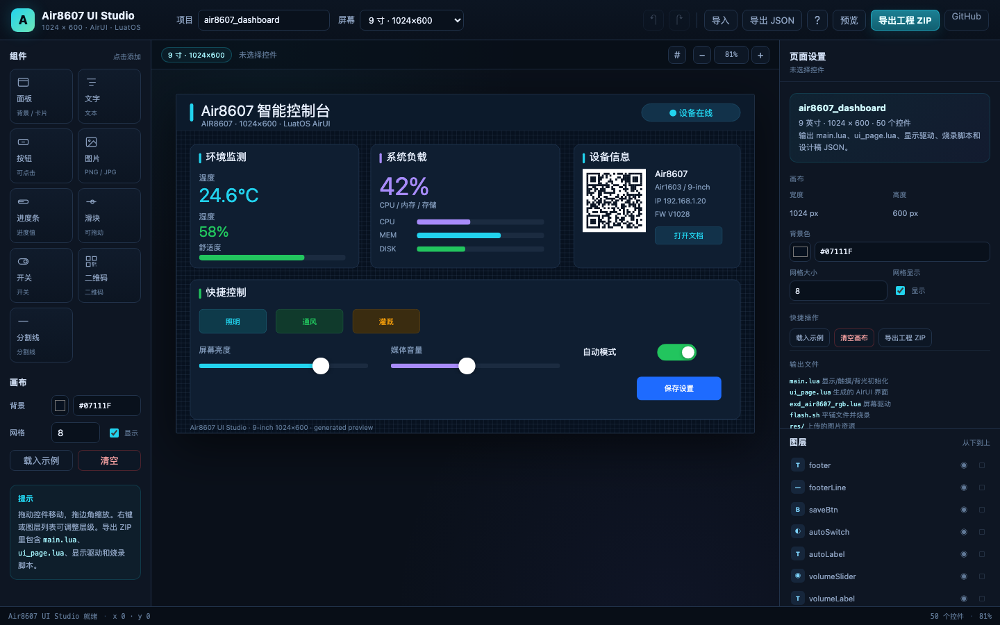

# Air8607 LuatOS 开发环境 + 网页版 UI Studio

面向 **Air8607（Air1603 / Air1101）9 英寸、10 英寸 1024×600 触摸屏** 的 LuatOS 开发仓库：包含可烧录的 factory 工程、AirUI 示例、Mac 原生烧录脚本，以及一个**浏览器里拖拽设计界面并生成可烧录 Lua 工程**的 UI Studio。

[](https://github.com/xiaohe4966/Air8607/actions/workflows/pages.yml)
[](./LICENSE)



## 在线使用 UI Studio

部署完成后访问：

**<https://xiaohe4966.github.io/Air8607/>**

无需安装、无需后端，直接拖拽控件，导出 ZIP 后按里面的 `flash.sh` 烧录。也可以在本地运行：

```bash
cd Air8607
python3 -m http.server 8000
# 浏览器打开 http://127.0.0.1:8000/ui_designer/
```

## 这个仓库有什么

```text
Air8607/
├── ui_designer/                 # 网页版 9/10 寸 AirUI 设计器
├── factory/                     # Air8607 factory 工程（默认 9 寸配置）
│   ├── config/eng_8607_9i_v0.lua
│   ├── config/eng_8607_10i_v0.lua
│   └── lib/                     # 工厂工程需要的标准 LuatOS 扩展库
├── airui_showcase/              # AirUI 视觉特效/组件示例
├── agri_greenhouse/             # 农业大棚仪表盘示例
├── firmware/                    # 固件下载说明（.soc 在 Releases）
├── docs/ui-designer.png         # UI Studio 截图
├── flash_mac.sh                 # 烧录 factory / 查看日志
├── flash_project.sh             # 烧录 UI Studio 导出的独立工程
├── LICENSE
└── THIRD_PARTY_NOTICES.md
```

## UI Studio 功能

- 画布固定 **1024×600**，可切换 **9 寸 / 10 寸**（生成代码里的 `SCREEN_SIZE` 不同）。
- 组件：面板、文字、按钮、图片、进度条、滑块、开关、二维码、分割线。
- 拖拽移动、8 点缩放、网格吸附、方向键微调、图层置顶/置底。
- 属性面板：颜色、圆角、边框、字号、数值、对齐、图片上传。
- 撤销/重做、预览模式、自动保存到浏览器、设计稿 JSON 导入/导出。
- 导出 ZIP 包含：
  - `main.lua`：显示、GT911 触摸、背光、AirUI 初始化
  - `ui_page.lua`：生成的界面代码，按钮/滑块/开关带 `TODO` 事件桩
  - `exd_air8607_rgb.lua`：1024×600 RGB 屏初始化扩展
  - `flash.sh`：自动平铺文件并烧录
  - `README.md`、`design.json`、`res/`（上传的图片）
- 生成工程已用 `luatos-cli` 的 LuaDB 编译器验证，可直接打包烧录。

## 硬件与屏幕

- 开发板：**Air8607**，固件平台 **Air1603**，底层芯片 **Air1101**。
- 屏幕：9 寸 / 10 寸 RGB 1024×600，免初始化序列。
- 触摸：GT911，I2C1（400 kHz），`RST=GPIO14`，`INT=GPIO51`。
- 显示：`LCD_RST=GPIO15`，`LCD_PWR=GPIO17`，背光 `PWM3`（GPIO13）。
- RGB 时序：`hbp=140, hspw=20, hfp=160, vbp=20, vspw=3, vfp=12`，50 MHz。
- Air8607 本身**没有 WiFi/4G**；联网需要 Air8603 或外接模块。

> 9 寸面板驱动 IC 以卖家配置为准。仓库按官方文档的 JD9165BA/GT911 与 1024×600 免序列参数配置；如果显示或触摸异常，先核对排线、面板 IC 和卖家给的 9 寸配置。

## 快速开始（Mac）

### 1. 准备工具

- 安装 `luatos-cli`：<https://github.com/openLuat/luatos-cli/releases>
  - 可以放到 `PATH`，或设置 `LUATOS_CLI=/path/to/luatos-cli`。
- 如果 Mac 看不到串口，安装 WCH CH343 驱动：
  <https://www.wch.cn/downloads/CH34XSER_MAC_ZIP.html>
- 下载固件并放到 `firmware/`：见 [firmware/README.md](./firmware/README.md)。

### 2. 烧录 factory 工程

```bash
cd Air8607
./flash_mac.sh ports          # 确认串口
./flash_mac.sh full           # 首次：全量刷出厂固件 + 当前 9 寸 factory
./flash_mac.sh script         # 日常：只刷脚本/资源区
./flash_mac.sh log            # 查看串口日志
```

`flash_mac.sh full` 使用 `firmware/Air8607_Factory_001.999.001_LuatOS-SoC_V1028_Air1603_102.soc`；`script` 使用内核 `.soc`。脚本会自动把 `factory/` 平铺到临时目录，避免 Air1603 LuaDB 的 27 字节文件名限制。

### 3. 烧录 UI Studio 导出的工程

从网页导出 ZIP，解压后：

```bash
cd air8607_dashboard-air8607
chmod +x flash.sh
./flash.sh /dev/cu.usbmodemXXXX full     # 首次：内核 + UI
./flash.sh /dev/cu.usbmodemXXXX script   # 以后只刷 UI
```

或者用仓库里的通用脚本：

```bash
./flash_project.sh /path/to/air8607_dashboard-air8607
./flash_project.sh /path/to/air8607_dashboard-air8607 /dev/cu.usbmodemXXXX full
```

### 4. 切换 9 寸 / 10 寸 factory 配置

- 9 寸：`factory/config/eng_8607_9i_v0.lua`（当前默认）
- 10 寸：`factory/config/eng_8607_10i_v0.lua`
- 编译列表和 `PROJECT_MAP` 在 `factory/core/platform_loader.lua`。

两者分辨率、RGB 时序、GT911 引脚相同，差异主要是 `screen_size` 和工程名。UI Studio 生成代码时也会写入对应的 `SCREEN_SIZE = 9/10`。

## 验证状态

- 已用 `luatos-cli` 对 factory 工程和 UI Studio 生成工程做过 Lua 编译与 LuaDB 打包验证；打包只停在“未连接串口”这一步。
- 当前开发环境没有连接 Air8607 实机，**显示、GT911 触摸、背光和运行时行为尚未在硬件上验证**。首次上电前请先核对屏幕排线、面板 IC 和卖家配置。
- 9 寸面板驱动 IC 在官方文档中出现 JD9165BA，也有 Air8602 9 寸工程使用 HX8282；如果显示异常，优先确认实际面板型号。

## 重要说明

- `factory/main.lua` 里的 `PROJECT_KEY` 已替换为 `YOUR_PROJECT_KEY`，避免开源仓库泄露密钥。使用合宙 IoT/FOTA 功能前请填自己的项目密钥。
- 固件 `.soc` 不提交到 Git，放在 [Releases](https://github.com/xiaohe4966/Air8607/releases/latest)。
- UI Studio 的二维码预览是示意图；烧录后由 AirUI 生成真实二维码。
- 上传图片会放进生成的 `res/`，烧录脚本平铺到 `/luadb/`，代码引用 `/luadb/<文件名>`。脚本区 4096 KB，图片建议压缩到 300 KB 以内。

## 开发与验证

```bash
# UI Studio 纯静态，无构建步骤
cd ui_designer
python3 -m http.server 8000

# 生成工程语法/LuaDB 打包验证（需要 luatos-cli + 内核 .soc）
./flash_project.sh /path/to/generated-project /dev/cu.nonexistent script
```

## 致谢与许可

- LuatOS / openLuat：MIT License
- Air8607 factory、AirUI 示例、农业大棚示例：合宙官方示例，MIT License
- 本仓库新增的 UI Studio、9 寸配置、Mac 脚本：MIT License

详见 [LICENSE](./LICENSE) 和 [THIRD_PARTY_NOTICES.md](./THIRD_PARTY_NOTICES.md)。
