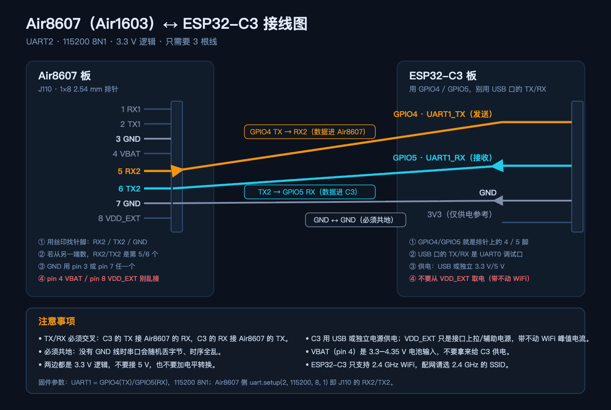

# Air8607 + ESP32-C3 WiFi 网卡

Air8607（Air1603）本身没有 WiFi。这个方案用一颗 ESP32-C3 作为「串口网卡」：

```text
┌──────────────┐   UART2 115200 8N1   ┌──────────────┐   WiFi/HTTPS   ┌──────────────────────┐
│   Air8607    │  J110 RX2  <---------│  ESP32-C3    │<-------------->│ tool.he4966.cn       │
│  (Air1603)   │  J110 TX2  --------->│  UART1       │                │ get_my_ip            │
│              │  GND       ----------│  GPIO4/GPIO5 │                └──────────────────────┘
└──────────────┘                      └──────────────┘
```

ESP32-C3 负责 WiFi 连接、HTTPS 请求和 JSON 解析；Air8607 只负责发送命令、解析结果并更新 AirUI 标签。
请求只在 ESP32-C3 启动并连上 WiFi 后执行一次，之后 Air8607 的 `FETCH` 返回缓存。

HTTPS 证书校验需要正确的系统时间。ESP32-C3 上电默认从 1970 年开始，因此固件会先用
SNTP（`ntp.aliyun.com` / `cn.pool.ntp.org` / `pool.ntp.org`）对时，再请求 API；
如果 SNTP 超时，会退回到固件编译时间，避免证书被判定为「尚未生效」。

## 接线



矢量原图：[`docs/wiring/air8607-c3-wiring.svg`](./wiring/air8607-c3-wiring.svg)

Air8607 的 J110 是 1×8 2.54 mm 排针，其中包含 UART1 和 UART2：

| Air8607 J110 | 信号 | 方向 | ESP32-C3 |
| --- | --- | --- | --- |
| pin 5 | `RX2` | ← | GPIO4 `UART1_TX` |
| pin 6 | `TX2` | → | GPIO5 `UART1_RX` |
| pin 3 或 7 | `GND` | ↔ | `GND` |

J110 完整针脚（官方原理图）：`1 RX1`、`2 TX1`、`3 GND`、`4 VBAT`、`5 RX2`、
`6 TX2`、`7 GND`、`8 VDD_EXT`。

接线步骤：

1. 断电，先认清 J110 上印着 `RX2` / `TX2` / `GND` 的三个针脚（丝印优先，不要盲数）。
2. 一根杜邦线：**C3 的 GPIO4 → J110 pin 5（RX2）**。
3. 一根杜邦线：**J110 pin 6（TX2）→ C3 的 GPIO5**。
4. 一根杜邦线：**J110 pin 3 或 pin 7（GND）→ C3 的 GND**。
5. C3 插 USB 供电，Air8607 照常供电。

注意：

- **TX/RX 必须交叉**：ESP32-C3 的 TX 接 Air8607 的 RX，反之亦然。
- **必须共地**，否则串口会随机丢字节。
- 两边都是 3.3 V 逻辑，不需要电平转换。不要把 5 V 信号直接接进来。
- **不要接 C3 板上 USB 口旁边的 `TX`/`RX`**：那是 UART0 调试口（固件日志用的），必须用 **GPIO4/GPIO5**。
- 调试阶段 ESP32-C3 用 USB 供电。量产时用独立的 3.3 V/5 V 电源，留足 WiFi 峰值电流。
- **不要用 Air1603 的 `VDD_EXT` 给 ESP32-C3 供电**。该引脚是接口上拉/小电流辅助电源，带不动 WiFi 峰值。
- **`VBAT`（pin 4）是 3.3–4.35 V 电池输入**，也不要拿来给 C3 供电。
- ESP32-C3 只支持 2.4 GHz WiFi，不支持 5 GHz。配网时请选择 2.4 GHz SSID。

Air8607 侧使用 LuatOS `uart.setup(2, ...)`，对应 UART2；J110 的 `RX2/TX2` 就是 UART2。

## 目录

| 路径 | 说明 |
| --- | --- |
| `esp32c3_wifi_bridge/` | ESP-IDF 固件：WiFi、配网 HTTP、HTTPS、UART 协议 |
| `examples/air8607_c3_wifi/` | Air8607 LuatOS 工程：UI + UART2 客户端 |
| `esp32c3_wifi_bridge/main/main.c` | 固件主逻辑 |
| `examples/air8607_c3_wifi/net_bridge.lua` | Air8607 侧行协议客户端 |
| `docs/wiring/` | 接线图（PNG + SVG 矢量原图） |
| `docs/dev-environment.md` | 换台电脑继续开发的环境搭建指南 |

## 1. 烧录 ESP32-C3

要求 ESP-IDF 5.4 或兼容的 5.x。已验证版本：ESP-IDF 5.4.3。

```bash
cd esp32c3_wifi_bridge
source ~/esp/v5.4/esp-idf/export.sh
idf.py set-target esp32c3
idf.py build
```

在本机测试时，CH343 的 `/dev/cu.usbmodem...` 接口在写入时会失败，而
`/dev/cu.wchusbserial...` 正常。因此使用：

```bash
python -m esptool --chip esp32c3 -p /dev/cu.wchusbserialXXXX \
  -b 115200 --no-stub --before default_reset --after hard_reset \
  write_flash --no-compress --flash_mode dio --flash_size 4MB --flash_freq 40m \
  0x0 build/bootloader/bootloader.bin \
  0x8000 build/partition_table/partition-table.bin \
  0x10000 build/air8607_c3_wifi_bridge.bin
```

或者用脚本：

```bash
./flash_c3.sh /dev/cu.wchusbserialXXXX
```

`idf.py flash` 默认会上传 stub。本机测试时 stub 上传报
`Failed to write to target RAM (result was 0107: Checksum error)`，
所以脚本使用 `--no-stub` 走 ROM loader。换 USB 口/线/供电后，`idf.py flash` 也可能恢复正常。

## 2. 配网

第一次启动，或保存的 WiFi 连接失败时，ESP32-C3 会开热点：

- SSID：`Air8607-C3`
- 密码：`air8607wifi`
- 配置页：<http://192.168.4.1/>

手机连接热点，填写目标 WiFi 的 SSID 和密码，保存后 ESP32-C3 写入 NVS 并自动重启。
连接成功后请求一次 API，然后通过 UART1 返回结果。

生产环境建议修改 `esp32c3_wifi_bridge/main/main.c` 里的 `AP_PASS`，或把配网页改成一次性
配网（保存后关闭 AP）。当前实现为了调试方便，连接失败时会重新开 AP。

## 3. 烧录 Air8607 示例

示例工程在 `examples/air8607_c3_wifi/`，已经包含：

- `main.lua`：启动 `net_bridge`
- `net_bridge.lua`：UART2 行协议客户端
- `ui_page.lua`：新增 `infoTime` 标签和 `M.set_network_info`
- `design.json`：已加入 `infoTime` 控件

```bash
cd examples/air8607_c3_wifi
./flash.sh /dev/cu.usbmodemXXXX full    # 首次：内核 + 工程
./flash.sh /dev/cu.usbmodemXXXX script  # 以后只刷脚本
```

或者从仓库根目录：

```bash
./flash_project.sh examples/air8607_c3_wifi /dev/cu.usbmodemXXXX script
```

启动后控制台页「设备信息」卡片会先显示 `IP 获取中...`，几秒后显示公网 IP 和时间。
如果没接 ESP32-C3，会显示 `IP 等待网卡...`；如果 ESP32-C3 在配网模式，会显示 `IP 配网中...`。

## 4. 串口协议

物理层：115200 8N1，无流控，按行分隔（`\n`），JSON 单行。

Air8607 → ESP32-C3：

| 命令 | 作用 |
| --- | --- |
| `HELLO` | 查询固件版本 |
| `STATUS` | 查询 WiFi、局域网 IP、请求状态 |
| `FETCH` | 获取缓存的 `netinfo`；未就绪时返回 `not_ready` |
| `PING` | 心跳 |
| `REBOOT` | 重启 ESP32-C3（重新请求 API） |

ESP32-C3 → Air8607：

```json
{"type":"hello","fw":"1.0.0","proto":1}
{"type":"netinfo","ok":true,"code":1,"msg":"ok","ip":"180.113.152.47","date":"2026-10-24 11:26:02","time":1792812362,"local_ip":"192.168.1.23"}
```

失败示例：

```json
{"type":"netinfo","ok":false,"code":0,"msg":"","err":"not_ready","wifi":false,"mode":"ap","local_ip":""}
```

`ip` 是 API 返回的**公网 IP**（`data` 字段）；`local_ip` 是 ESP32-C3 在局域网里的地址。
`date` 已从 `20261024 11:26:02` 规范化为 `2026-10-24 11:26:02`。
`time` 是 Unix 时间戳，可能是数字或字符串，Air8607 侧不依赖它。

## 5. 已完成的验证

ESP32-C3：

```text
I (451) air8607-c3: Air8607 ESP32-C3 WiFi bridge 1.0.0
I (451) air8607-c3: UART bridge: GPIO4 TX -> Air8607 RX2, GPIO5 RX <- Air8607 TX2
I (561) air8607-c3: UART1 ready: TX=GPIO4 RX=GPIO5 115200 8N1
W (651) air8607-c3: no WiFi credentials; starting provisioning AP
I (721) air8607-c3: provisioning AP: SSID=Air8607-C3 password=air8607wifi http://192.168.4.1/
I (731) air8607-c3: provisioning web server listening on http://192.168.4.1/
```

- 芯片：ESP32-C3 QFN32 rev v0.3，4 MB MXIC flash，MAC `60:55:f9:71:d8:e0`。
- 固件编译、烧录、启动、UART1 初始化、配网 AP + HTTP 服务均通过。
- 已确认 `/dev/cu.wchusbserial...` 可以稳定写入，`/dev/cu.usbmodem...` 在本机 Hub 上会写失败。

Air8607：

```text
I/user.main display ready display 1024 600
I/user.ui_page page built: page_1 控制台
I/user.main GT911 touch ready
I/user.main backlight on
I/user.net_bridge UART2 已启动，等待 ESP32-C3 网络信息
I/user.main AirUI page ready: air8607_c3_wifi
```

- 示例通过 `luatos-cli build luac` 编译。
- 已烧录到 Air8607 实机，UART2 客户端启动正常。
- **端到端**（真实 WiFi + HTTPS + Air8607 显示）需要在 J110 接好三根线，并在配网页填写 WiFi 后复测。
  当前代码路径已经打通，但受限于实机接线/凭据，尚未记录最终 API 返回值在屏幕上的照片。

## 6. 接线后自检（3 分钟）

接完线先别急着配网，按下面三步确认链路是通的：

```bash
# 1) 看 C3 的 USB 日志：有没有收到 Air8607 发来的 FETCH
python3 -c "
import serial,time
s=serial.Serial('/dev/cu.wchusbserialXXXX',115200,timeout=0.2)
end=time.time()+8
while time.time()<end:
    d=s.read(4096)
    if d: print(d.decode('utf-8','replace'))
"
# 期望看到： I (xxx) air8607-c3: UART RX[1]: FETCH
```

2. C3 日志出现 `UART RX: FETCH` 后，C3 会回一行 JSON（串口 TX 方向），
   Air8607 收到后屏幕上会从 `IP 等待网卡...` 变成 `IP 配网中...`（C3 还在配网模式）。
3. 手机连 `Air8607-C3` / `air8607wifi`，打开 <http://192.168.4.1/> 填 2.4 GHz WiFi。
   C3 重启 → 连 WiFi → 对时 → 请求 API → 屏幕显示 `IP 180.x.x.x` 和 `时间 2026-10-24 11:26:02`。

如果第 1 步没有 `UART RX: FETCH`，先别配网，回去查线（见下一节）。

## 7. 排错

### Air8607 一直显示 `IP 等待网卡...`

1. 确认 ESP32-C3 已上电，USB 日志能看到 `UART1 ready`。
2. 确认 J110 pin 5 `RX2` 接 ESP32-C3 GPIO4，pin 6 `TX2` 接 GPIO5（交叉）。
3. 确认 GND 已连接。
4. 在 ESP32-C3 串口日志里看有没有 `UART RX: FETCH`。如果没有，说明 Air8607 的 TX2 没有到 GPIO5：
   - 检查 J110 引脚编号是否从 1 开始、是否看反。
   - 检查 DuPont 线是否断线。
   - 确认 Air8607 工程里是 `uart.setup(2, ...)`，不是 UART1/UART3。
5. 如果有 `UART RX: FETCH` 但 Air8607 没反应，检查 ESP32-C3 GPIO4 到 J110 pin 5 这一根线（TX 方向）。

### Air8607 显示 `IP 配网中...`

ESP32-C3 没有 WiFi 凭据，或连不上保存的网络。手机连接 `Air8607-C3` / `air8607wifi`，
打开 <http://192.168.4.1/> 重新配网。确认选择的是 2.4 GHz WiFi。

### ESP32-C3 配网热点找不到

- 确认 ESP32-C3 已上电，USB 日志有 `provisioning AP`。
- ESP32-C3 只支持 2.4 GHz；手机/电脑要能扫描 2.4 GHz。
- 如果之前保存过错误凭据，串口日志会先尝试 STA 约 30 秒，然后才开 AP；耐心等待或重新烧录并擦除 NVS。

### HTTPS 请求失败

日志会打印 `HTTP status`、`http_open:...` 或 `json_parse`。常见原因：

- WiFi 能连上但没有外网，或 DNS 不可用。
- NTP 被网络阻断导致系统时间不对：日志会出现 `SNTP sync timed out`，随后会尝试用编译时间兜底；
  如果证书仍然校验失败，换一个允许 NTP 的网络或改用可用的 NTP 服务器。
- 目标站点证书链变化；可更新 ESP-IDF 的证书 bundle 后重新编译。当前证书由 Let's Encrypt
  `YR2` 签发，链路可回到 `ISRG Root X1`，ESP-IDF 5.4 的 full bundle 已包含该根证书。
- 内存不足：C3 只有约 400 KB RAM，HTTPS 峰值较高；当前固件已用 `-Os`，实测启动后仍有约 150 KB 可用堆。

### 串口写入失败（macOS）

- 优先用 `/dev/cu.wchusbserial...`。
- 如果 `usbmodem` 接口报 `0107 Checksum error` 或 `0105 format invalid`，换 USB 口/线，避免无源 Hub。
- 本机全量烧录 Air8607 时也遇到过 Hub 掉线；拔插 USB 后恢复。

## 8. 生产化建议

- 修改默认 AP 密码，或增加配网完成后的 AP 关闭逻辑。
- 增加 WiFi 断线重连后的重新请求策略（当前只在启动时请求一次；需要刷新时发 `REBOOT`）。
- 如果产品需要 Air8607 主动触发刷新，可在协议里增加 `FETCH FORCE`，由 ESP32-C3 重新请求 HTTPS。
- 给 ESP32-C3 设计独立电源和足够的去耦电容，避免 WiFi 峰值导致复位。
- 如果结构允许，把 ESP32-C3 的 UART1 直接布到 Air8607 的 J110，缩短线缆。
